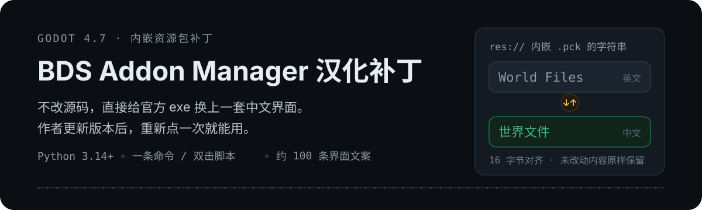
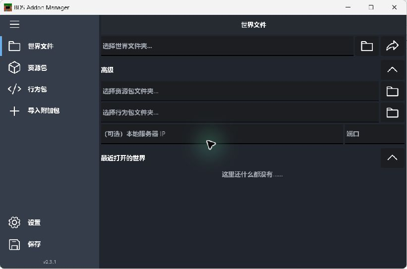
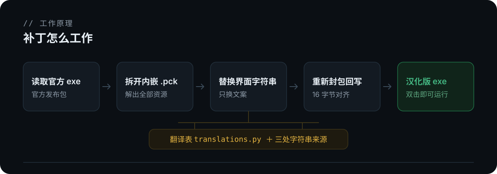

<p align="center">
  
</p>

一个给 [BDS Addon Manager](https://github.com/DragonTech26/BDSAddonManager) 做简体中文界面的补丁工具。

它不碰源代码，直接读官方发布的 `BDS Addon Manager.exe`，把里面内嵌的界面文案换成中文，再吐出一个新的 exe。作者更新版本之后，我只要对它重新跑一次，就能得到对应新版本的中文版。

汉化覆盖主界面、设置页、帮助页和各个弹窗按钮，一共约 100 条文案、18 个资源文件。中文字体交给引擎的系统中文字体回退来显示，不用额外装字体，Windows 上开箱即用。

<p align="center">
  
</p>

## 怎么用

需要 Python 3.14 或更高版本（补丁用到标准库里的 zstd 解压模块）。

1. 拿到官方的 `BDS Addon Manager.exe`，放在任意位置。
2. 把 exe **拖到 `一键汉化.bat` 上**松开；或者双击脚本，再按提示把路径粘进去。
3. 脚本会在同一个目录里生成 `BDS Addon Manager 汉化版.exe`，双击就是中文版。

习惯命令行的话，走这条：

```bash
python src/patch.py "BDS Addon Manager.exe"
```

不写输出路径时，默认生成「原文件名 + 空格 + 汉化版.exe」；想放到别处，再接一个参数就行。

> [!TIP]
> 建议把汉化版放在桌面或程序原来的目录里运行。少数安全软件会拦截「新生成、又在非常规目录里」的 exe。

## 工作原理

<p align="center">
  
</p>

这个程序用 Godot 4.7 打包，界面文案散在两个地方：编译后的 GDScript 字节码（`.gdc`）和二进制场景文件（`.scn`）。补丁把 exe 末尾内嵌的 Godot 资源包（`.pck`）拆开，分开处理，再原样封回去。

- **`.gdc` 脚本**：文件是一段 zstd 压缩的字节码，界面字符串以明文字符串常量存在里面。补丁解压、替换常量、重新压缩；字符串的个数和索引保持不变，脚本逻辑不受影响。
- **`.scn` 场景**：主界面、设置页、帮助页的文案存在场景内部一个自描述的 Variant 字典里。补丁按 Godot 的二进制资源格式正规解析，只替换真正的字符串值，节点名和属性名一概不动。
- **资源包本身**：重建 `.pck` 时保持每个文件的原始顺序和 16 字节对齐，并同步更新 PE 头里 `pck` 段的大小，让 exe 仍然被系统当成合法程序。

逻辑用的键、节点路径、主题名这些带代码含义的字符串一律跳过，所以不会因为翻译把程序改坏。

## 翻译表

所有译文集中在 `src/translations.py` 的 `TRANS` 字典里，键是英文原文，值是中文；补一条翻译就加一行。

```python
TRANS = {
    "World Files": "世界文件",
    # ...
}
```

键必须和程序里的字符串逐字符一致，匹配上才替换。作者在新版本里新增的英文，只要还没进表就保持英文显示，不影响使用。

## 已知限制

- 补丁按「英文原文完全相同」来匹配。作者改过措辞的那条会暂时保持英文，等翻译表同步即可。
- 程序会在 `%APPDATA%\Godot\app_userdata\BDS Addon Manager\` 下缓存日志和着色器。补丁不碰这个目录；如果你同时开了多个副本、把日志文件占住了，程序可能起不来，把 `logs` 文件夹挪走再开就行。
- 安全软件可能拦截新生成的 exe，见上面那条建议。

## 目录结构

```text
.
├── 一键汉化.bat          # 面向使用者的双击入口
├── src/
│   ├── patch.py          # 命令行入口
│   ├── pckbuild.py       # 解包 / 重建 Godot .pck
│   ├── gdc.py            # GDScript 字节码的读写
│   ├── gvariant.py       # Godot 二进制 Variant 编解码
│   ├── scene.py          # 二进制场景解析与替换
│   └── translations.py   # 英文 → 中文翻译表
└── assets/readme/        # README 用的视觉素材
```

## 说明

本项目只做界面本地化，不包含也不分发 BDS Addon Manager 本体，原程序版权归其作者所有。
